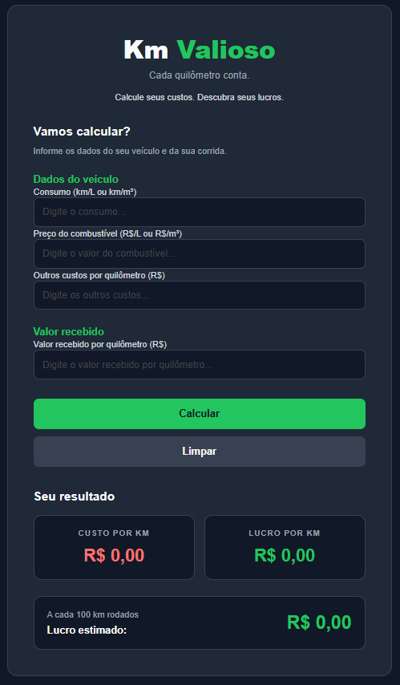
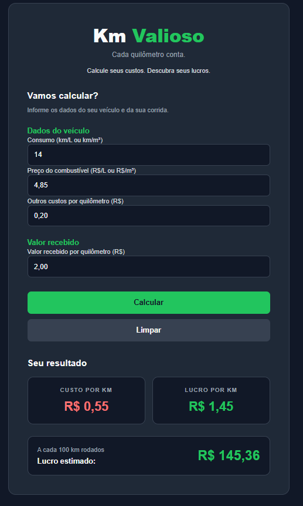

# 🚗 Km Valioso

**Cada quilômetro conta.**


Uma aplicação web simples para ajudar motoristas de aplicativo, taxistas e profissionais autônomos a calcular seus custos e descobrir quanto realmente lucram por quilômetro rodado.

---

## 🎯 Objetivo do projeto

O Km Valioso foi desenvolvido com o objetivo de facilitar o controle dos custos operacionais de veículos, permitindo que o motorista tenha uma visão mais clara dos seus gastos e dos seus ganhos.

---

## ⚙️ Funcionalidades

- [x] Estrutura inicial em HTML5.
- [x] Formulário para inserir os dados do veículo.
- [x] Campo para informar o consumo de combustível.
- [x] Campo para informar o preço do combustível.
- [x] Campo para informar outros custos por quilômetro.
- [x] Campo para informar o valor recebido por quilômetro.
- [x] Layout responsivo.
- [x] Cálculo automático do custo por quilômetro.
- [x] Cálculo automático do lucro por quilômetro.
- [x] Estimativa de lucro a cada 100 km rodados.
- [x] Limpeza dos campos e resultados.


---

## 🛠️ Tecnologias utilizadas

- HTML5
- CSS3
- JavaScript

---

## 📸 Prévia do projeto




---

## 💻 Como executar o projeto

1. Clone este repositório:

    ````bash
    git clone https://github.com/adrivancabral/km-valioso
    ````

2. Entre na pasta do projeto.

3. Abra o arquivo `index.html` no navegador.

---

## 🚀 Melhorias futuras

- [ ] Implementar novos recursos de cálculo.
- [ ] Melhorar a experiência visual da aplicação.
- [ ] Adicionar suporte a diferentes tipos de combustível.
- [ ] Aprimorar a responsividade para dispositivos móveis.

---

## 👨‍💻 Autor

**Adrivan de Azevedo Santos Cabral**

- GitHub: [@adrivancabral](https://github.com/adrivancabral)
- LinkedIn: [Adrivan Cabral](https://www.linkedin.com/in/adrivan-cabral-746ba2222/)

---

## 📚 Sobre o projeto

Este projeto faz parte da minha jornada de aprendizado em desenvolvimento web, com foco na prática de HTML, CSS e JavaScript, desenvolvendo soluções simples para problemas do dia a dia.